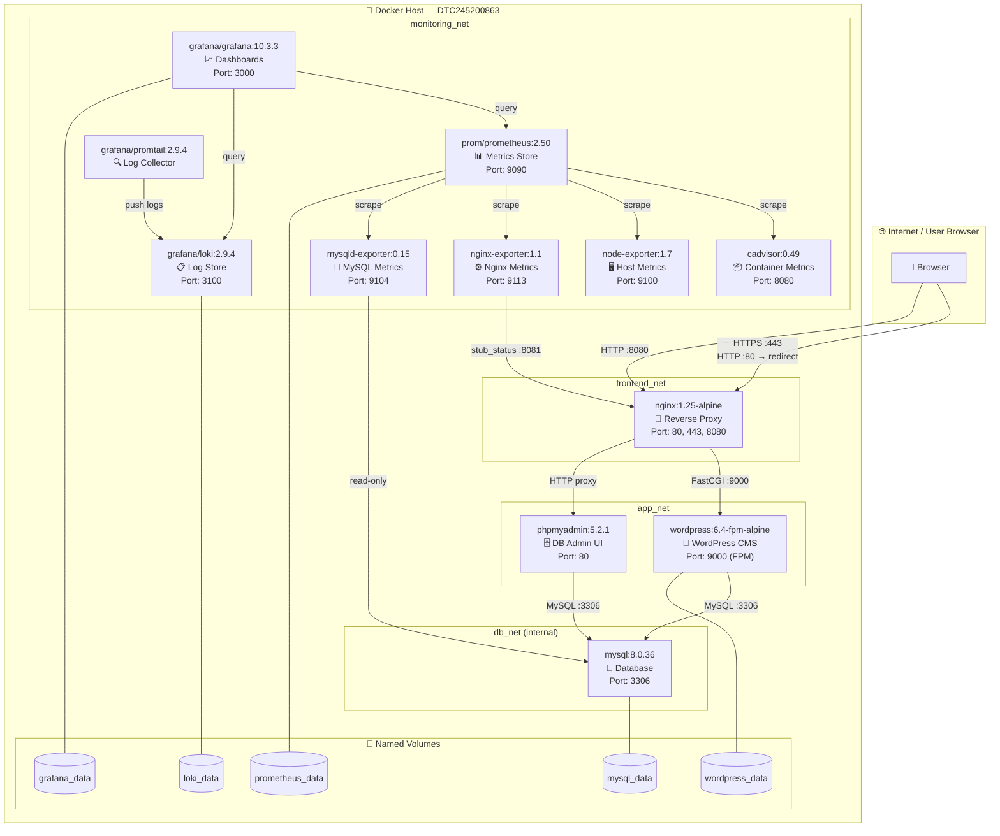

# Architecture Diagram — TechPro WordPress

## Mermaid Source

## Service Responsibilities

| Service | Image | Role | Network |
|---|---|---|---|
| nginx | nginx:1.25-alpine | Reverse proxy, HTTPS termination, security headers | frontend_net, app_net |
| wordpress | wordpress:6.4.3-fpm-alpine | WordPress PHP-FPM application | app_net, db_net |
| mysql | mysql:8.0.36 | Relational database | db_net (internal) |
| phpmyadmin | phpmyadmin:5.2.1 | Database management UI | app_net, db_net |
| prometheus | prom/prometheus:v2.50.1 | Metrics collection and storage | monitoring_net |
| grafana | grafana/grafana:10.3.3 | Dashboards and visualization | monitoring_net |
| loki | grafana/loki:2.9.4 | Log aggregation and query | monitoring_net |
| promtail | grafana/promtail:2.9.4 | Log collector (EOL, academic use) | monitoring_net |
| cadvisor | gcr.io/cadvisor/cadvisor:v0.49.1 | Container CPU/memory metrics | monitoring_net |
| node_exporter | prom/node-exporter:v1.7.0 | Host OS metrics | monitoring_net |
| nginx_exporter | nginx/nginx-prometheus-exporter:1.1.0 | Nginx stub_status metrics | monitoring_net, frontend_net |
| mysql_exporter | prom/mysqld-exporter:v0.15.1 | MySQL performance metrics | monitoring_net, db_net |

## Network Isolation

- **frontend_net**: Only Nginx is exposed externally. Browser → Nginx only.
- **app_net**: Nginx ↔ WordPress ↔ phpMyAdmin communication.
- **db_net** (internal): MySQL only reachable from app_net services. NOT exposed to host.
- **monitoring_net**: Isolated monitoring stack. Prometheus, Grafana, Loki, exporters.

## Port Exposure Summary

| Port | Service | Binding | Purpose |
|---|---|---|---|
| 80 | nginx | 0.0.0.0 | HTTP (redirects to 443) |
| 443 | nginx | 0.0.0.0 | HTTPS (WordPress) |
| 8080 | nginx | 0.0.0.0 | phpMyAdmin |
| 9090 | prometheus | 127.0.0.1 | Prometheus UI (local only) |
| 3000 | grafana | 127.0.0.1 | Grafana UI (local only) |
| 3100 | loki | 127.0.0.1 | Loki API (local only) |
| 3306 | mysql | NOT EXPOSED | Internal only |
| 9100 | node_exporter | NOT EXPOSED | Internal only |
| 9104 | mysql_exporter | NOT EXPOSED | Internal only |
| 9113 | nginx_exporter | NOT EXPOSED | Internal only |
